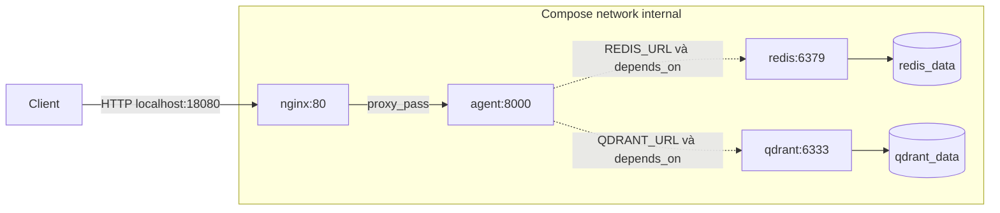

# Day 14 Lab Mission Answers

## Part 1 Localhost vs Production

Thực hiện Exercise 1.1–1.3 trên Ubuntu 24.04 trong WSL2 lúc 15:53 ngày 25/11/2026 (GMT+7). Môi trường: Python 3.12.3 (`posix`), FastAPI 0.115.0, Uvicorn 0.30.0 và python-dotenv 1.0.1. Các câu trả lời của agent dùng mock LLM.

### Exercise 1.1 Anti-patterns

| Vấn đề trong bản develop | Vị trí | Tác hại |
| --- | --- | --- |
| API key và database credentials hardcode | `develop/app.py:17–18` | Nếu là credentials thật, push code sẽ làm lộ quyền truy cập; cần đọc từ environment. |
| In API key ra log | `develop/app.py:34` | Secret tiếp tục bị lộ qua terminal hoặc hệ thống thu thập log. |
| `DEBUG` và `MAX_TOKENS` cố định trong code | `develop/app.py:21–22` | Đổi cấu hình giữa các môi trường phải sửa source. |
| Port cố định `8000` | `develop/app.py:52` | Không dùng được port do nền tảng deploy cấp qua biến `PORT`. |
| Bind vào `localhost` | `develop/app.py:51` | Trong container, service không nhận kết nối từ bên ngoài network namespace của container. |
| Luôn bật `reload=True` | `develop/app.py:53` | Chạy thêm file watcher/reloader, không phù hợp khi phục vụ production. |
| Không có `/health` và `/ready` | `develop/app.py:25–30` chỉ khai báo `/` và `/ask` | Thiếu endpoint riêng để kiểm tra liveness và readiness. |
| Dùng `print()` thay cho logging | `develop/app.py:33–38` | Khó lọc theo level, tổng hợp và truy vấn log có cấu trúc. |
| Không có lifecycle cleanup riêng | Toàn bộ `develop/app.py` | Không khai báo bước đóng connection hoặc giải phóng tài nguyên khi app tắt. Uvicorn vẫn có shutdown mặc định, nên không thể kết luận bản develop luôn tắt đột ngột. |

Các đường dẫn trên tính từ [01-localhost-vs-production](01-localhost-vs-production/). Không chép lại giá trị credentials mẫu vào câu trả lời.

### Exercise 1.2 Chạy bản develop

Cổng 8000 đã có tiến trình khác sử dụng. Lần kiểm tra này chạy app develop trên `127.0.0.1:18001` qua Uvicorn, không sửa source hoặc dừng tiến trình đang dùng cổng 8000.

Dependencies được cài trong `01-localhost-vs-production/.venv/`, là đường dẫn đã được Git ignore. Từ gốc repo trong Ubuntu:

```bash
source 01-localhost-vs-production/.venv/bin/activate
cd 01-localhost-vs-production/develop
python -m uvicorn app:app --host 127.0.0.1 --port 18001
```

Trong terminal Ubuntu thứ hai:

```bash
curl -i -X POST "http://127.0.0.1:18001/ask?question=Hello"
```

Trích response thực tế:

```http
HTTP/1.1 200 OK

{"answer":"Agent đang hoạt động tốt! (mock response) Hỏi thêm câu hỏi đi nhé."}
```

Bản develop nhận `question` qua query. Gửi JSON như ví dụ cũ trong `CODE_LAB.md` trả **422**, với thông báo thiếu `query.question`; cách gọi đúng theo lưu ý K5 trong `README.md` là dùng query như trên. Nội dung mock response có thể đổi giữa các lần chạy.

### Exercise 1.3 So sánh với bản production

| Feature | Develop | Production | Tại sao quan trọng |
| --- | --- | --- | --- |
| Config | Giá trị cố định trong source | `Settings` đọc environment trong `production/config.py` | Dùng cùng code/image cho nhiều môi trường. |
| Secrets | Hardcode và in key ra log | Đọc từ environment; handler không in key | Giảm nguy cơ lộ credentials qua source và log. |
| Host và port | `localhost:8000` trong entrypoint | Đọc `HOST`, `PORT`; mặc định `0.0.0.0:8000` | Nhận kết nối trong container và dùng port của nền tảng. |
| Reload | Luôn bật trong entrypoint | Phụ thuộc `DEBUG`, mặc định tắt | Tránh chạy file watcher không cần thiết trong production. |
| Health check | `/health` trả 404 | `/health` trả 200, có uptime/version/environment | Cung cấp liveness endpoint cho nền tảng giám sát. |
| Readiness | `/ready` trả 404 | `/ready` trả 200 sau startup; code trả 503 khi `is_ready=False` | Load balancer có thể tránh chuyển traffic khi app chưa sẵn sàng. |
| Logging | `print()`, có in key | Có code định dạng JSON và event; lần chạy mock này không phát log app ở level INFO, xem ghi chú dưới | Log cần có level và cấu trúc hợp lệ để tìm lỗi, tổng hợp dữ liệu. |
| Shutdown | Không có cleanup riêng; Uvicorn vẫn thực hiện shutdown mặc định | Có `lifespan` startup/shutdown và handler SIGTERM; kiểm tra thoát code 0 | Có nơi đóng tài nguyên khi service dừng. |
| Input `/ask` | Query parameter `question` | JSON body có `question`; `{}` trả 422 | Client phải tuân theo đúng hợp đồng API của từng bản. |

Để chạy lại bản production, từ gốc repo trong một terminal Ubuntu mới:

```bash
source 01-localhost-vs-production/.venv/bin/activate
cd 01-localhost-vs-production/production
HOST=127.0.0.1 PORT=18002 DEBUG=false ENVIRONMENT=staging python app.py
```

Các biến được truyền trực tiếp cho process; không tạo hoặc sửa `.env`. Trong terminal thứ hai:

```bash
curl -i http://127.0.0.1:18002/health
curl -i http://127.0.0.1:18002/ready
curl -i -X POST http://127.0.0.1:18002/ask \
  -H 'Content-Type: application/json' \
  -d '{"question":"Hello"}'
```

Trích response `/ask` thực tế:

```http
HTTP/1.1 200 OK

{"question":"Hello","answer":"Agent đang hoạt động tốt! (mock response) Hỏi thêm câu hỏi đi nhé.","model":"gpt-4o-mini"}
```

`model` là nhãn cấu hình của bản mẫu; request trên vẫn gọi mock LLM, không gọi API LLM thật.

### Kết quả kiểm tra

| Bản | Request | HTTP thực tế | Đánh giá |
| --- | --- | ---: | --- |
| Develop | `GET /` | 200 | PASS |
| Develop | `POST /ask?question=Hello` | 200 | PASS |
| Develop | `POST /ask`, JSON `{"question":"Hello"}` | 422 | PASS — thiếu query parameter |
| Develop | `GET /health` | 404 | PASS — endpoint chưa được khai báo |
| Develop | `GET /ready` | 404 | PASS — endpoint chưa được khai báo |
| Production | `GET /` | 200 | PASS — environment là `staging` |
| Production | `GET /health` | 200 | PASS — `status=ok`, environment là `staging` |
| Production | `GET /ready` | 200 | PASS — `ready=true` |
| Production | `POST /ask`, JSON `{"question":"Hello"}` | 200 | PASS |
| Production | `POST /ask`, JSON `{}` | 422 | PASS — `question field is required` |

**10/10 kiểm tra HTTP đúng kết quả mong đợi.** Các mã 404/422 trong bảng là kết quả chủ đích của từng trường hợp, không phải mọi endpoint đều sẵn sàng cho production. `python -m pip check` trả `No broken requirements found.`

Sau các request, gửi SIGTERM vào đúng process production do phiên kiểm tra tạo ra. Process thoát với **exit code 0**, log Uvicorn có:

```text
INFO:     Shutting down
INFO:     Waiting for application shutdown.
INFO:     Application shutdown complete.
INFO:     Finished server process [1039]
```

Đây là kiểm tra shutdown sau khi các request đã hoàn thành; chưa đo khả năng hoàn tất request đang xử lý khi nhận SIGTERM. Cả hai process kiểm tra đã được dừng.

**Ghi chú logging:** khi không đặt `OPENAI_API_KEY`, `production/config.py:45` gọi `logging.warning()` trong lúc import config, trước `logging.basicConfig()` ở `production/app.py:28`. Warning khởi tạo root logger với level WARNING; lần `basicConfig()` sau không thay cấu hình đó. Lần chạy thực tế ghi nhận warning dùng mock, không có event `agent_request` và có **0 dòng log app theo format JSON**. Vì vậy, chưa thể coi structured logging của bản mẫu là hoạt động đúng trong cấu hình này. Phần này giữ nguyên code mẫu để đối chiếu.

### Checkpoint 1

- Hardcode secret có thể làm lộ quyền truy cập qua Git; log secret tạo thêm một nguồn rò rỉ.
- Environment variables cho phép đổi cấu hình giữa dev/staging/production mà không sửa source.
- Liveness trả lời process còn hoạt động; readiness trả lời app có sẵn sàng nhận traffic. Readiness của bản mẫu này chỉ dựa trên cờ startup, chưa kiểm tra dependency thật.
- Graceful shutdown ngừng nhận việc mới, chờ công việc đang xử lý và cleanup tài nguyên trước khi thoát; cần phân biệt thiết kế đó với phạm vi shutdown đã kiểm tra ở trên.

## Part 2 Docker

Kết quả runtime được kiểm tra lúc 20:52 ngày 25/11/2026 (GMT+7), Docker Engine 29.9.3 và Compose v5.7.0. Số đo, response và trạng thái service được lưu trong [reports/cp2_docker.json](reports/cp2_docker.json).

### Exercise 2.1 Dockerfile cơ bản

1. **Base image:** [Dockerfile develop](02-docker/develop/Dockerfile) dùng `FROM python:3.11`, cung cấp Python cùng hệ điều hành và thư viện nền. Container đã build thực tế chạy Python 3.11.18.
2. **Working directory:** `WORKDIR /app`. Các lệnh `COPY`, `RUN` dùng đường dẫn tương đối và lệnh khởi động được thực hiện từ `/app`.
3. **Copy requirements trước source:** Docker có thể tái sử dụng layer `pip install` khi chỉ code app thay đổi. Khi `requirements.txt` đổi, layer cài dependencies và các layer sau nó được build lại. `pip --no-cache-dir` tắt cache tải package của pip, không tắt Docker layer cache.
4. **CMD và ENTRYPOINT:** `CMD` đặt command/arguments mặc định, có thể bị thay bằng arguments của `docker run`. `ENTRYPOINT` xác định executable chính; khi dùng exec form, arguments của `docker run` được nối sau executable và thay phần mặc định của `CMD`. Ví dụ `ENTRYPOINT ["python"]` cùng `CMD ["app.py"]` cho phép `docker run image other.py` chạy `python other.py`. Dockerfile develop hiện dùng `CMD ["python", "app.py"]`. Tham khảo [Dockerfile reference](https://docs.docker.com/reference/dockerfile/).

### Exercise 2.2 Build và chạy container develop

Build từ **gốc repo**, vì các đường dẫn `COPY` tính theo build context:

```bash
docker build -f 02-docker/develop/Dockerfile -t my-agent:develop .
docker run --rm -d --name k5-day14-cp2-develop \
  -p 127.0.0.1:18001:8000 my-agent:develop
curl -i http://127.0.0.1:18001/health
curl -i -X POST "http://127.0.0.1:18001/ask?question=What%20is%20Docker%3F"
```

Dùng cổng host 18001 vì cổng 8000 đang được một project khác sử dụng. Trích response `/ask` thực tế:

```http
HTTP/1.1 200 OK

{"answer":"Container là cách đóng gói app để chạy ở mọi nơi. Build once, run anywhere!"}
```

`GET /health` trả 200 với `container=true`. Bản develop nhận query parameter; gửi JSON `{"question":"What is Docker?"}` vào `/ask` trả 422, thiếu `query.question`. Đây là khác biệt đã nêu trong lưu ý K5 của `README.md`.

Sau khi thử lại có thể dừng đúng container này bằng `docker stop k5-day14-cp2-develop`; `--rm` sẽ tự gỡ container sau khi dừng.

### Exercise 2.3 Multi-stage build và kích thước image

[Dockerfile production](02-docker/production/Dockerfile) có hai stage:

- **Builder:** dùng `python:3.11-slim`, cài `gcc`, `libpq-dev` và cài Python dependencies vào `/root/.local`.
- **Runtime:** bắt đầu từ một `python:3.11-slim` mới, copy packages sang `/home/appuser/.local`, copy source và mock utils, chạy bằng `appuser`. Command chạy Uvicorn với hai worker và có `HEALTHCHECK`.

Runtime không copy các layer cài build tools từ builder. Mức giảm còn đến từ việc đổi base image full sang slim; không thể quy toàn bộ chênh lệch cho riêng số lượng stage. Base Python slim vẫn có pip.

```bash
docker build -f 02-docker/production/Dockerfile -t my-agent:advanced .
docker images my-agent --format '{{.Repository}}:{{.Tag}} | {{.Size}}'
docker image inspect my-agent:develop my-agent:advanced --format '{{.RepoTags}} | {{.Size}}'
```

Output `docker images` thực tế:

```text
my-agent:develop | 1.67GB
my-agent:advanced | 240MB
```

| Image | Kích thước byte từ inspect | MB thập phân, 1 MB = 1.000.000 byte | User kiểm tra trong container |
| --- | ---: | ---: | --- |
| `my-agent:develop` | 1667784235 | 1667.784235 | root, UID 0 |
| `my-agent:advanced` | 239815305 | 239.815305 | appuser, UID 999 |

Mức giảm: `(1667784235 - 239815305) / 1667784235 × 100 = 85.620724%`, làm tròn **85,62%**. Image production dưới 500 MB. Đây là số đo local của hai image đã build, không phải dung lượng tải nén hoặc dung lượng cộng dồn của tất cả Docker images.

Container production được chạy riêng trên cổng 18002, `/health`, `/ready` và `/ask` đều trả 200; JSON rỗng vào `/ask` trả 422. Docker healthcheck đạt `healthy`; `pip check` trong cả hai image trả `No broken requirements found.`

### Exercise 2.4 Docker Compose stack

Stack có bốn service trên bridge network `internal`:



- **Nginx:** publish HTTP ra host, proxy tới `agent:8000`, cấu hình rate limit và security headers.
- **Agent:** FastAPI với một container, hai worker Uvicorn. Chờ Redis và Qdrant healthy trước khi khởi động.
- **Redis:** được cấu hình cho session/cache/rate limiting, lưu dữ liệu trong named volume.
- **Qdrant:** vector database được cấu hình cho RAG, có named volume riêng.

Tên service được Docker DNS phân giải trong network. Các mũi tên nét đứt thể hiện cấu hình environment và dependency; `main.py` hiện chỉ gọi mock LLM, chưa triển khai logic session/Redis hoặc truy vấn RAG/Qdrant. Kiểm tra hạ tầng riêng đã xác nhận Redis `PONG` và HTTP từ agent tới Qdrant trả 200. Hai worker không đồng nghĩa hai container replica.

#### Cách chạy lại stack local

Compose gốc yêu cầu `.env.local`. Lần này dùng [docker-compose.lab.yml](02-docker/production/docker-compose.lab.yml) để bỏ yêu cầu env file cho mock LLM, gán image `my-agent:advanced` và thay port mapping bằng `127.0.0.1:18080:80`. Không tạo hoặc sửa file `.env`. Các tag `!reset` và `!override` thực hiện việc thay cấu hình theo [quy tắc merge của Docker Compose](https://docs.docker.com/reference/compose-file/merge/).

Từ gốc repo:

```bash
docker compose -p k5-day14-docker \
  -f 02-docker/production/docker-compose.yml \
  -f 02-docker/production/docker-compose.lab.yml \
  up -d --build --wait --wait-timeout 120

curl -i http://127.0.0.1:18080/health
curl -i http://127.0.0.1:18080/ready
curl -i -X POST http://127.0.0.1:18080/ask \
  -H 'Content-Type: application/json' \
  -d '{"question":"Explain microservices"}'
```

Trích response `/ask` qua Nginx thực tế:

```http
HTTP/1.1 200 OK
Server: nginx
X-Frame-Options: DENY
X-Content-Type-Options: nosniff

{"answer":"Tôi là AI agent được deploy lên cloud. Câu hỏi của bạn đã được nhận."}
```

#### Kết quả kiểm tra CP2

| Đường gọi | Request | HTTP thực tế |
| --- | --- | ---: |
| Develop, cổng 18001 | `GET /health` | 200 |
| Develop, cổng 18001 | `POST /ask?question=What%20is%20Docker%3F` | 200 |
| Develop, cổng 18001 | `POST /ask`, JSON có question | 422 |
| Production, cổng 18002 | `GET /health` | 200 |
| Production, cổng 18002 | `GET /ready` | 200 |
| Production, cổng 18002 | `POST /ask`, JSON có question | 200 |
| Production, cổng 18002 | `POST /ask`, JSON `{}` | 422 |
| Qua Nginx, cổng 18080 | `GET /health` | 200 |
| Qua Nginx, cổng 18080 | `GET /ready` | 200 |
| Qua Nginx, cổng 18080 | `POST /ask`, JSON có question | 200 |
| Qua Nginx, cổng 18080 | `POST /ask`, JSON `{}` | 422 |

**11/11 kiểm tra HTTP đúng kết quả mong đợi.** Trước khi dừng stack, cả bốn service đều `running`; agent, Redis, Qdrant có healthcheck `healthy`; Nginx không có Docker healthcheck riêng, được xác nhận bằng request HTTP và `nginx -t` thành công.

Để debug, dùng cùng project name và hai file Compose cho mọi lệnh:

```bash
docker compose -p k5-day14-docker \
  -f 02-docker/production/docker-compose.yml \
  -f 02-docker/production/docker-compose.lab.yml logs --tail 30 agent

docker compose -p k5-day14-docker \
  -f 02-docker/production/docker-compose.yml \
  -f 02-docker/production/docker-compose.lab.yml exec agent id

docker compose -p k5-day14-docker \
  -f 02-docker/production/docker-compose.yml \
  -f 02-docker/production/docker-compose.lab.yml down
```

Stack CP2 và các container test riêng đã được dừng sau kiểm tra; giữ image và named volumes. Các container project có sẵn trên máy vẫn chạy.

**Lưu ý:** Compose cảnh báo trường `version` trong file gốc đã obsolete nhưng vẫn chạy thành công. `HEALTHCHECK` đánh dấu health status, không tự restart chỉ vì container bị `unhealthy`; comment trong Dockerfile mẫu diễn đạt chưa chính xác. Xem [Dockerfile HEALTHCHECK](https://docs.docker.com/reference/dockerfile/#healthcheck).

## Part 4 API Security

CP3 thực hiện Exercise 4.1–4.4 theo `CHECKPOINTS.md`, trước phần cloud deployment.

Kiểm tra thực tế lúc 21:57 ngày 25/11/2026 (GMT+7), Python 3.12.3 trong WSL2, FastAPI 0.115.0, Uvicorn 0.30.0, PyJWT 2.15.1 và Pydantic 2.14.4. Dependencies cài trong `04-api-gateway/.venv/`. Bằng chứng có response `curl -i` đã che token tại [reports/cp3_api_security.json](reports/cp3_api_security.json).

### Exercise 4.1 API key authentication

- [develop/app.py](04-api-gateway/develop/app.py) khai báo `APIKeyHeader(name="X-API-Key", auto_error=False)` và kiểm tra key trong `verify_api_key()`. Route `/ask` gọi dependency này bằng `Depends(verify_api_key)`.
- Thiếu key trả **401**; key sai trả **403** trong bản mẫu này. `/health` là public endpoint. Đây là hành vi của Part 4, không thay thế hợp đồng 401 cho key sai của Part 6.
- Key được đọc từ environment `AGENT_API_KEY`. Rotate key bằng cách cập nhật secret của service, restart/redeploy process để nạp giá trị mới và cập nhật client. Bản mẫu chỉ nhận một key tại một thời điểm nên không hỗ trợ giai đoạn chồng lấp hai key.
- Entrypoint `python app.py` của bản mẫu in API key ra terminal. Không đưa các dòng đó vào bài nộp; có thể chạy qua Uvicorn CLI để tránh thực thi phần in key trong `__main__`.

### Exercise 4.2 JWT authentication

Luồng trong [production/auth.py](04-api-gateway/production/auth.py):

1. Client gửi thông tin tài khoản demo tới **`POST /auth/token`**. Không dùng `/token` trong ví dụ cũ của `CODE_LAB.md`.
2. `authenticate_user()` đối chiếu tài khoản. User `student` có role `user`; `teacher` có role `admin`. Sai thông tin đăng nhập trả 401.
3. `create_token()` ký JWT bằng **HS256**, đọc khóa ký từ `JWT_SECRET`. Claims gồm `sub`, `role`, `iat`, `exp`; thời hạn token là **60 phút**.
4. Client gửi `Authorization: Bearer <token>` khi gọi `/ask`. `verify_token()` kiểm tra chữ ký, algorithm và expiry trước khi trả username/role cho handler.
5. Thiếu token trả 401 kèm `WWW-Authenticate: Bearer`; token hết hạn trả 401; token không hợp lệ trả 403 theo code mẫu. `/admin/stats` chỉ cho role admin, user thường nhận 403.

JWT có chữ ký để phát hiện sửa payload; payload không được mã hóa để giấu dữ liệu. Không đưa secrets vào claims hoặc commit token vào repo. Mẫu có JWT secret mặc định và tài khoản demo trong source; khi triển khai thực tế cần khóa ký riêng trong secret/environment và cơ chế quản lý tài khoản phù hợp.

### Exercise 4.3 Rate limiting

[production/rate_limiter.py](04-api-gateway/production/rate_limiter.py) dùng **sliding window**: mỗi username có một `deque` lưu timestamp của từng request, loại timestamp ngoài cửa sổ 60 giây, rồi kiểm tra số phần tử còn lại. Đây không phải token bucket.

| Role | Instance limiter | Giới hạn |
| --- | --- | --- |
| User | `rate_limiter_user` | 10 request / 60 giây |
| Admin | `rate_limiter_admin` | 100 request / 60 giây |

`production/app.py` chọn limiter theo role lấy từ JWT đã xác thực. Admin dùng quota cao hơn, **không được bỏ qua mọi giới hạn**. Khi hết quota, response là **429**, có `Retry-After`, `X-RateLimit-Limit`, `X-RateLimit-Remaining` và `X-RateLimit-Reset`.

State hiện nằm trong RAM của process. Restart làm mất quota; nhiều worker/instance sẽ có bộ đếm riêng. Bản triển khai scale cần state dùng chung như Redis và thao tác kiểm tra/ghi nhận atomic.

### Exercise 4.4 Cost guard

Rate limit bảo vệ số request trong một khoảng thời gian; cost guard bảo vệ tổng chi phí. Request ít nhưng dài hoặc dùng model đắt vẫn có thể vượt ngân sách, nên cần cả hai.

**Logic có sẵn trong [production/cost_guard.py](04-api-gateway/production/cost_guard.py):**

- Budget **1 USD/ngày cho mỗi user**, **10 USD/ngày toàn service**, cảnh báo khi user dùng từ 80%. Đây là cấu hình của code mẫu, khác bài toán 10 USD/tháng trong đoạn hướng dẫn cũ.
- `check_budget()` kiểm tra chi phí đã ghi nhận trước khi gọi mock LLM. Hết budget user trả **402**; hết budget toàn service trả **503**.
- Sau khi mock LLM trả lời, `record_usage()` cộng input/output tokens và chi phí theo các hằng số giá minh họa trong source. Tokens của app được ước lượng bằng số từ nhân hai; đây không phải tokenizer hoặc hóa đơn LLM thật.
- Usage lưu trong RAM; record của user được thay khi ngày thay đổi. Biến `_global_today` chưa được dùng để reset `_global_cost`, nên code hiện chưa tự reset budget global qua ngày mới.
- `check_budget()` chưa nhận `estimated_cost`; một request được phép bắt đầu khi số đã dùng còn dưới budget có thể làm tổng chi vượt budget sau khi hoàn thành.
- Response `/ask` gán `usage.budget_remaining_usd` bằng `usage.total_cost_usd`, tức số **đã dùng**. Endpoint `/me/usage` mới tính phần còn lại bằng budget trừ số đã dùng. Cần phân biệt hai giá trị khi đọc kết quả.

**Thiết kế cho yêu cầu 10 USD/tháng với Redis:** dùng key `budget:<user_id>:<YYYY-MM>` theo UTC. Trước khi gọi LLM, kiểm tra `spent + estimated_cost <= 10` và giữ chỗ chi phí trong cùng một Lua script hoặc transaction atomic; vượt thì từ chối. Sau request, điều chỉnh phần giữ chỗ theo usage thực tế. Tháng mới dùng key mới, TTL dọn key cũ; không xóa toàn bộ Redis để reset. Việc kiểm tra rồi tăng số dư bằng hai lệnh độc lập có thể cho các request đồng thời cùng vượt budget.

Theo CP3 trong `CHECKPOINTS.md`, phần này giải thích logic của ví dụ có sẵn; không viết lại các mẫu Part 1–5. Rate limit và cost guard dùng Redis sẽ được tự xây trong Part 6.

### Kết quả runtime CP3

Hai app được chạy qua Uvicorn CLI, bind `127.0.0.1`: develop ở **18041**, production ở **18042**, tránh cổng 8000 của project khác. API key và JWT signing secret được tạo ngẫu nhiên trong bộ nhớ và truyền qua environment cho process; không tạo hoặc sửa `.env`. Khi rotate API key, process develop được khởi động lại bằng key mới.

| Trường hợp | Kết quả thực tế |
| --- | --- |
| Develop `/health` public | 200 |
| Develop `/ask` thiếu API key | 401 |
| Develop `/ask` sai API key | 403 |
| Develop `/ask` key đúng và JSON hợp lệ | 200 |
| Develop `/ask` key đúng nhưng thiếu question | 422 |
| Sau rotate, dùng key cũ | 403 |
| Sau rotate, dùng key mới | 200 |
| Production `/health` public | 200 |
| Production `/ask` thiếu JWT | 401 |
| Production `/ask` JWT không đúng định dạng | 403 |
| Production `/ask` JWT hết hạn | 401 |
| Production `/ask` JWT role admin nhưng ký bằng khóa khác | 403 |
| `/auth/token` sai thông tin đăng nhập | 401 |
| `/auth/token` tài khoản demo student và teacher hợp lệ | Đều 200; token được che trong report |
| Student gọi `/ask` liên tục, request 1–10 | 200 |
| Student gọi `/ask` liên tục, request 11–20 | 429 |
| Student gọi `/me/usage` sau vòng lặp | 200, ghi nhận 10 request được xử lý |
| Student gọi `/admin/stats` | 403 |
| Teacher gọi `/ask` sau khi student hết quota | 200, còn 99 request trong quota admin |
| Teacher gọi `/admin/stats` | 200 |
| Teacher gửi question rỗng vào `/ask` | 422 |

Tổng cộng **40/40 kiểm tra HTTP đúng kết quả mong đợi**. JWT student được kiểm tra chữ ký HS256 và claims `sub=student`, `role=user`, `exp - iat = 3600` giây. `pip check` trả `No broken requirements found.`

#### Output curl thiếu API key

Lệnh kiểm tra tương đương, khi app develop đang chạy:

```bash
curl -i -X POST http://127.0.0.1:18041/ask \
  -H 'Content-Type: application/json' \
  -d '{"question":"What is Docker?"}'
```

Trích output thực tế:

```http
HTTP/1.1 401 Unauthorized
content-type: application/json

{"detail":"Missing API key. Include header: X-API-Key: <your-key>"}
```

#### Output curl có API key hợp lệ

`AGENT_API_KEY` là biến chứa key của process develop trong phiên kiểm tra, không chèn giá trị vào bài:

```bash
curl -i -X POST http://127.0.0.1:18041/ask \
  -H "X-API-Key: $AGENT_API_KEY" \
  -H 'Content-Type: application/json' \
  -d '{"question":"What is Docker?"}'
```

```http
HTTP/1.1 200 OK
content-type: application/json

{"question":"What is Docker?","answer":"Container là cách đóng gói app để chạy ở mọi nơi. Build once, run anywhere!"}
```

#### Lấy JWT và kiểm tra rate limit

Lấy token bằng `POST /auth/token` với tài khoản demo student trong `auth.py`; lưu token vào biến `TOKEN`, không in token ra bài nộp. Trích response đã che dữ liệu nhạy cảm:

```http
HTTP/1.1 200 OK
content-type: application/json

{"access_token":"<REDACTED>","token_type":"bearer","expires_in_minutes":60,"hint":"<REDACTED>"}
```

Vòng lặp kiểm tra tương đương, bắt đầu với quota student mới và token của process production đang chạy:

```bash
for i in $(seq 1 20); do
  printf '\nRequest %s\n' "$i"
  curl -i -X POST http://127.0.0.1:18042/ask \
    -H "Authorization: Bearer $TOKEN" \
    -H 'Content-Type: application/json' \
    -d "{\"question\":\"Test $i\"}"
done
```

Trích output của **request 11** trong lần chạy thực tế:

```http
HTTP/1.1 429 Too Many Requests
x-ratelimit-limit: 10
x-ratelimit-remaining: 0
retry-after: 59
content-type: application/json

{"detail":{"error":"Rate limit exceeded","limit":10,"window_seconds":60,"retry_after_seconds":59}}
```

`Retry-After` phụ thuộc thời gian đã trôi qua trong cửa sổ; 59 giây là giá trị của lần chạy này. Các output trên trích những header cần thiết; report giữ phần header nhận được và body đã che token/hint.

#### Kiểm tra CostGuard bằng fixture

Ba kiểm tra sau gọi trực tiếp class `CostGuard` của bản mẫu, **không phải HTTP response từ app**, không phát sinh token hoặc chi phí với nhà cung cấp LLM:

| Fixture | Kết quả |
| --- | --- |
| Guard mới với budget mặc định, chưa ghi nhận usage | Cho phép request |
| Budget user 0.0005 USD; ghi nhận giả lập 1000 input + 1000 output tokens, chi phí theo hằng số mẫu là 0.00075 USD | Raise `HTTPException` có status 402 |
| Budget global 0.0005 USD; ghi nhận cùng lượng tokens giả lập | Raise `HTTPException` có status 503 |

**3/3 kiểm tra CostGuard đạt.** Mô phỏng record user thuộc ngày cũ rồi đọc lại usage cho thấy user cost reset về 0, nhưng global cost vẫn khoảng 0.00075 USD; xác nhận hạn chế reset global đã nêu ở Exercise 4.4.

Sau 10 request student được xử lý, `/ask` báo `usage.budget_remaining_usd=0.000169`, đúng bằng **cost đã dùng** trong `/me/usage`; phần budget còn lại thật sự tại `/me/usage` là `0.999831` trên budget 1 USD. Đây là số tính từ mock usage của lần chạy, không phải hóa đơn LLM thật.

Các process test đã dừng. Source mẫu được giữ nguyên; các hạn chế cost guard được ghi rõ để tránh nhầm ví dụ này với cơ chế quản lý ngân sách đầy đủ của Part 6.

## AI log

| Yêu cầu dùng AI | Nội dung AI hỗ trợ | Sửa và kiểm tra |
| --- | --- | --- |
| Đọc yêu cầu lab và kiểm tra Docker/WSL | Đối chiếu tài liệu, kiểm tra công cụ và chuẩn bị Ubuntu/WSL2, Python, Docker Integration | Người học tự tạo tài khoản Ubuntu; Codex kiểm tra Python `posix`, venv và Docker `hello-world`. |
| Làm phần tiếp theo sau setup, tức CP1 Part 1 | Phân tích anti-patterns, so sánh develop/production, chạy API và viết câu trả lời Part 1 | Codex không sửa source mẫu; trực tiếp chạy 10 kiểm tra HTTP, SIGTERM và `pip check` trong WSL2. Ghi lại hạn chế logging theo kết quả thực tế. Người học chưa xác nhận đã tự chạy lại và giải thích các kết quả Part 1. |
| Làm tiếp CP2 | Giải thích Dockerfile, build hai image, đo kích thước, vẽ sơ đồ và kiểm tra stack qua Nginx | Codex thêm Compose override cho mock và port local, không sửa `.env` hay Dockerfile mẫu. Trực tiếp chạy 11 kiểm tra HTTP, xác minh non-root/healthcheck/Redis/Qdrant/Nginx và lưu report thật. Người học chưa xác nhận đã tự chạy lại và giải thích các kết quả CP2. |
| Làm tiếp CP3 API Security | Phân tích API key, JWT, sliding window và cost guard; cài dependencies Part 4 sau khi người học cho phép | Codex chạy 40 kiểm tra HTTP, vòng lặp 20 request, rotate key và 3 kiểm tra CostGuard bằng fixture; che token/key trong report. Ghi nhận hạn chế reset global và nhãn budget trong response, không sửa source mẫu. Người học chưa xác nhận đã tự chạy lại và giải thích các kết quả CP3. |
